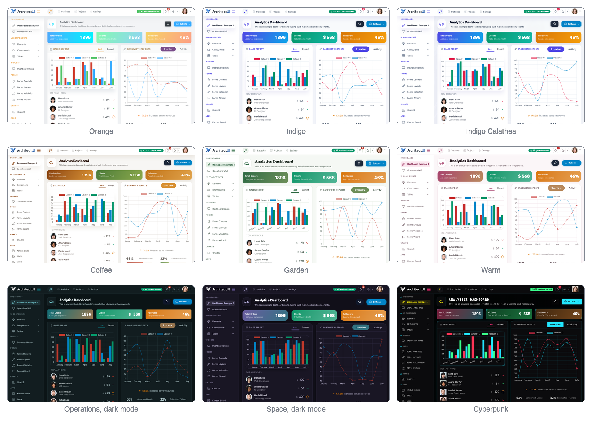

# ArchitectUI — Bootstrap 6 Admin Dashboard Theme

[](Changelog.md)
[](LICENSE)
[](https://getbootstrap.com)

ArchitectUI is a ready-made admin theme for Bootstrap 6. Write standard Bootstrap 6 markup and get a finished
admin interface: a page frame, every Bootstrap component, a dark mode and ten visual themes.

> **This branch is the version for Bootstrap 6** (`bootstrap@6.0.0-alpha.1`). It is an alpha version, as Bootstrap 6 is.
> The version for Bootstrap 5.3 is on the [`master`](https://github.com/wnikk/architectui-html-theme/tree/master) branch.
>
> - Browsers: Chrome and Edge 130, Firefox 132, Safari 18 and newer.
> - Pages written for Bootstrap 5 need the class names of Bootstrap 6. The [Changelog](Changelog.md) lists the changes.

[Download ZIP of this branch](https://github.com/wnikk/architectui-html-theme/archive/refs/heads/bootstrap-6.zip) ·
[Changelog](Changelog.md) ·
[Live demo of the Bootstrap 5 version](https://wnikk.github.io/architectui-html-theme/)


## Why ArchitectUI

| Advantage | What you get |
|-----------|--------------|
| **Standard Bootstrap markup** | Markup written for Bootstrap 6 works without changes. There is no second framework to learn. |
| **New Bootstrap 6 components** | Avatars, chips, stepper, OTP input, password strength, range, combobox, date picker, dialogs and drawers. |
| **Two files** | One stylesheet and one script without dependencies. Bootstrap and the icons come from a CDN. |
| **Bootstrap utilities win** | The theme rules are in the CSS layer `custom`. A Bootstrap utility changes any component without `!important`. |
| **No build step** | Copy the files and write HTML. Your project needs no jQuery, no bundler and no Node. |
| **Ten themes** | One extra stylesheet changes the look. Light, dark and system modes. |
| **48 demo pages** | Dashboards, forms, tables, charts, apps and sign-in pages. Copy the markup that you need. |
| **Ready for daily work** | Phones, wide monitors (1600 and 1920 px), a compact density and print styles. |
| **Ready for AI agents** | `AGENTS.md` and `docs/reference.md` tell a coding agent how to build pages with the theme. |

## Quick start

ArchitectUI is a template. Take your own copy and adapt it to your project.

1. Download the [ZIP of the `bootstrap-6` branch](https://github.com/wnikk/architectui-html-theme/archive/refs/heads/bootstrap-6.zip).
2. Copy these items from `dist/` to your project: `architectui.css`, `architectui.js`, `themes/`, `assets/` and `LICENSE`.
3. Add these lines to the `<head>` of your page:

   ```html
   <link rel="stylesheet" href="https://cdn.jsdelivr.net/npm/bootstrap@6.0.0-alpha.1/dist/css/bootstrap.min.css">
   <link rel="stylesheet" href="architectui.css">
   <script type="importmap">{ "imports": { "bootstrap": "https://cdn.jsdelivr.net/npm/bootstrap@6.0.0-alpha.1/dist/js/bootstrap.bundle.min.js" } }</script>
   <script type="module">import * as bootstrap from "bootstrap"; window.bootstrap = bootstrap; document.dispatchEvent(new Event("aui:bootstrap"));</script>
   <script defer src="https://cdn.jsdelivr.net/npm/lucide@1.65.0/dist/umd/lucide.min.js"></script>
   <script defer src="architectui.js"></script>
   ```

   Bootstrap 6 is an ES module. The import map gives it the name `bootstrap`. The inline module loads it and keeps it
   as `window.bootstrap` for the theme script and for your scripts.

4. Start from a demo page and replace its content with your Bootstrap markup:
   - `dist/pages-starter.html` — a page with the frame (header, sidebar, page title, footer);
   - `dist/pages-login.html` — a page without the frame. It loads `architectui-auth.js` instead of `architectui.js`; copy that file too.

All paths are relative. The pages work from any folder of a web server and from disk.

## Themes

`architectui.css` alone gives the default look, Business. A theme is one more stylesheet. It changes the colors,
type, radii and shadows. The markup stays the same.



| Theme | Id | Look |
|-------|----|------|
| Business | default | Dense, small type, lines instead of shadows |
| Orange | `orange` | Orange accents, color gradients, soft shadows |
| Indigo | `indigo` | Indigo palette, floating header and sidebar, vivid gradients |
| Indigo Calathea | `indigo-img` | Indigo with a photo of leaves behind the content |
| Coffee | `coffee` | Warm browns, soft shadows, compact sizes |
| Garden | `green` | Calm green, serif headings, airy rows |
| Warm | `raspberry` | Berry accent, pill buttons, round corners |
| Operations | `teal` | Zebra tables, monospace numbers |
| Space | `violet` | Large radii, violet shadows, heavy headings |
| Cyberpunk | `cyberpunk` | Neon on black, monospace, dark only |

Users select a theme and a mode in the header. The browser keeps the selection.
To set one theme for all users, add its id and its stylesheet:

```html
<html data-aui-theme="coffee">
<link rel="stylesheet" href="architectui.css">
<link rel="stylesheet" href="themes/coffee.css">
```

## Demo pages

Each page is complete. The links open the page source in `dist/`. To see the pages, download the ZIP of this branch
and open `dist/index.html` from disk.

| Group | Pages |
|-------|-------|
| Dashboards | [Analytics](dist/index.html) · [Operations Wall](dist/dashboard-operations.html) · [Dashboard Boxes](dist/dashboard-boxes.html) |
| Elements | [Buttons](dist/elements-buttons-standard.html) · [Dropdowns](dist/elements-dropdowns.html) · [Icons](dist/elements-icons.html) · [Badges](dist/elements-badges-labels.html) · [Cards](dist/elements-cards.html) · [List Groups](dist/elements-list-group.html) · [Navigation](dist/elements-navigation.html) · [Utilities](dist/elements-utilities.html) · [Theme Palettes](dist/elements-palettes.html) |
| Components | [All Bootstrap 6 components](dist/components-bootstrap.html) · [Tabs](dist/components-tabs.html) · [Accordions](dist/components-accordions.html) · [Notifications](dist/components-notifications.html) · [Modals](dist/components-modals.html) · [Progress](dist/components-progress-bar.html) · [Tooltips and Popovers](dist/components-tooltips-popovers.html) · [Carousel](dist/components-carousel.html) · [Calendar](dist/components-calendar.html) · [Pagination](dist/components-pagination.html) · [Scroll areas](dist/components-scrollable-elements.html) · [Maps](dist/components-maps.html) |
| Forms | [Controls](dist/forms-controls.html) · [Layouts](dist/forms-layouts.html) · [Validation](dist/forms-validation.html) · [Wizard](dist/forms-wizard.html) |
| Tables and charts | [Bootstrap tables](dist/tables-regular.html) · [DataTables](dist/tables-datatables.html) · [Chart.js](dist/charts-chartjs.html) |
| Apps | [Kanban board](dist/apps-kanban.html) · [Inbox](dist/apps-inbox.html) · [Users](dist/apps-users.html) · [Notifications](dist/apps-notifications.html) |
| Pages | [Starter](dist/pages-starter.html) · [Invoice](dist/pages-invoice.html) · [Pricing](dist/pages-pricing.html) · [Search](dist/pages-search.html) · [Settings](dist/pages-settings.html) · [Profile](dist/pages-profile.html) |
| Sign-in and errors | [Sign in](dist/pages-login.html) · [Sign up](dist/pages-register.html) · [Password reset](dist/pages-forgot-password.html) · [403](dist/pages-403.html) · [404](dist/pages-404.html) · [500](dist/pages-500.html) · [Maintenance](dist/pages-maintenance.html) |

## Customize

- **Colors, radii, shadows and sizes** are CSS variables. Change them in your own stylesheet after `architectui.css`:

  ```css
  :root {
    --aui-brand-solid: #3f6ad8;
    --aui-brand-text: light-dark(#3f6ad8, #8fb0f0);
  }
  ```

  The [Theme Palettes](dist/elements-palettes.html) page shows every color of every theme with its class and variable.
- **Layout** options are attributes on `<html>`. They set a fixed or static header, sidebar and footer, a collapsed sidebar,
  a compact density and the header and sidebar colors. Users change them on the [Profile](dist/pages-profile.html#interface) page.
- **Icons** are [Lucide](https://lucide.dev): `<i data-lucide="rocket"></i>`. The [Icons](dist/elements-icons.html) page has a search and copies a name on click.
- **Logo**: replace `assets/images/logo.svg` and `assets/images/logo-on-dark.svg`.

## Documentation

| Document | Content |
|----------|---------|
| [`docs/reference.md`](docs/reference.md) | The complete reference for people and AI agents: page template, frame markup, layout attributes, script API, themes, variables, component classes |
| [`AGENTS.md`](AGENTS.md) | A short guide for AI coding agents: files, steps to build a page, rules |
| [`llms.txt`](llms.txt) | A short index in the [llms.txt](https://llmstxt.org) format |
| [`Changelog.md`](Changelog.md) | The changes of each version and the move from Bootstrap 5 to Bootstrap 6 |

## Development

You need Node 22 or newer only to change the theme sources or the demo pages.

```bash
npm install
npm run dev
```

`npm run dev` serves the demo at http://localhost:8080 and builds again on each change. `npm run build` writes the files to `dist/`.

```
src/pages/      demo pages and their scripts
src/_includes/  page layouts and partials
src/_data/      menu, theme list, demo data, CDN addresses
src/scss/       theme styles; themes/ has one file for each theme
src/js/         theme scripts
dist/           built files: copy these to your project
```

## License

MIT, see [LICENSE](LICENSE).

## Authors

Inspired by ArchitectUI by DashboardPack.
