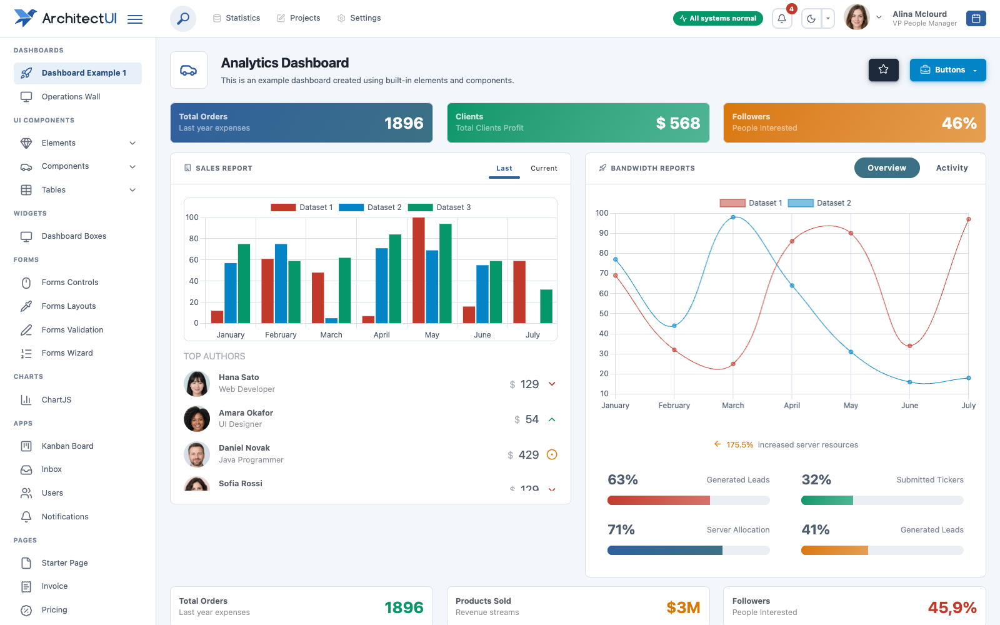

# ArchitectUI Bootstrap 6 HTML Theme

ArchitectUI is a clean, responsive admin dashboard theme. It is a thin layer on top of Bootstrap 6:
one stylesheet and one dependency-free script. Bootstrap and the icons come from a CDN, so any markup written
for Bootstrap 6 works inside the theme without changes, and you never rebuild Bootstrap.



**Demo:** https://wnikk.github.io/architectui-html-theme/

This version is built on `bootstrap@6.0.0-alpha.1`. Bootstrap 6 needs Chrome and Edge 130, Firefox 132 or Safari 18 and newer:
it uses `light-dark()`, `:has()`, container queries, CSS layers and the native `<dialog>` element without fallbacks. Pages written for
Bootstrap 5 need the Bootstrap 6 class names (see `Changelog.md`).

## What you get

- `dist/architectui.css` — the theme: layout, components, colors and dark mode in the default Business look, all driven by CSS variables. Its rules live in the CSS layer `custom` that Bootstrap 6 leaves to the project, so Bootstrap utilities keep winning over the theme.
- `dist/architectui.js` — the theme behavior of the admin pages: collapsible sidebar, interface settings, theme and mode switching, header search, file drop zone, icon rendering.
- `dist/architectui-auth.js` — the script of the guest pages (sign in, sign up, errors) instead of `architectui.js`: mode toggle, icons, form steps with a verification code.
- `dist/themes/*.css` — nine optional visual themes loaded on top of `architectui.css`, including Orange, the original ArchitectUI look.
- Wide screens and dense pages: grid and display classes with the `3xl:` prefix (from 1860 px) after Bootstrap `2xl` for 1920 px monitors, a compact density setting, the Operations Wall demo page.
- `dist/*.html` — demo pages: dashboards (including the Operations Wall for wide screens), elements, every Bootstrap 6 component on one page (the new ones included: avatars, chips, stepper, OTP input, password strength, range, combobox, date picker, dialogs and drawers, nav overflow), a starter page, a profile page with the interface settings, guest pages (sign in, sign up, password reset, errors 403, 404 and 500, maintenance), Bootstrap tables and DataTables, components, forms (including a wizard in several steps), a Kanban board, an inbox, a user list with a dialog form, a notifications center, workspace settings in sections, an invoice ready for print, pricing plans, search results, the palettes of all themes, tables, charts, calendar and maps.
- Page path and print: breadcrumbs in the header or a path line with a Back link above the page title (`aui-page-path`, `data-aui-back`); print styles that put only the page content on paper in the light mode (`data-aui-print` opens the print dialog, `print:d-none` keeps an element off paper).
- No jQuery, no build step for your app. Icons are [Lucide](https://lucide.dev).

## Quick start

ArchitectUI is a template: take your own copy and adapt it to your project. The built files are in the `dist/`
folder of this repository, always the latest version (its number is in `package.json` and `Changelog.md`).

Download the repository as a [ZIP of the `master` branch](https://github.com/wnikk/architectui-html-theme/archive/refs/heads/master.zip)
or clone it. A fixed version is on the [Releases](https://github.com/wnikk/architectui-html-theme/releases) page: its ZIP holds the `dist/` files of that version. Copy from `dist/` the files `architectui.css`, `architectui.js` (and `architectui-auth.js` for sign-in pages),
the folders `themes/` and `assets/` to your project, then add to `<head>`:

```html
<link rel="stylesheet" href="https://cdn.jsdelivr.net/npm/bootstrap@6.0.0-alpha.1/dist/css/bootstrap.min.css">
<link rel="stylesheet" href="architectui.css">
<script type="importmap">{ "imports": { "bootstrap": "https://cdn.jsdelivr.net/npm/bootstrap@6.0.0-alpha.1/dist/js/bootstrap.bundle.min.js" } }</script>
<script type="module">import * as bootstrap from "bootstrap"; window.bootstrap = bootstrap;</script>
<script defer src="https://cdn.jsdelivr.net/npm/lucide@1.65.0/dist/umd/lucide.min.js"></script>
<script defer src="architectui.js"></script>
```

Bootstrap 6 is an ES module without a global object. The import map names it `bootstrap` for every module on the page, and the inline module
loads it (its data API starts on import) and keeps it as `window.bootstrap` for the classic scripts of the theme and of your pages.

Themes load from the folder next to `architectui.css`. Logos, avatars and other images are part of your markup:
keep `assets/` next to the pages or change the paths. The copy is yours: change the variables, the sources in `src/`
and the demo pages as your project needs, and build them again with `npm run build`.

All links are relative, and the theme and page scripts are classic `defer` scripts. The demo works from any folder of a local
server and from disk (`file://`): the only module is inline and imports Bootstrap from the CDN. The theme script adds one global, `window.ArchitectUI`.
Markup that a script inserts later renders its icons by itself; Bootstrap 6 tooltips, popovers and the other data-API components initialise themselves.
`ArchitectUI.token("primary")`, `ArchitectUI.rgba("primary", .5)` and `ArchitectUI.chartDefaults(Chart)` give page scripts the colors of the current theme as `#rrggbb` values.

The demo pages link the theme files with `?v=<version>` (for example `architectui.css?v=7.0.0`), so a new version reaches
visitors past their browser cache. Do the same on your pages; the theme stylesheets keep the query.

Start from `dist/pages-starter.html` for a page with the frame (header, sidebar, page title, footer) and from
`dist/pages-login.html` for a page without it.

## Icons

Write an element with the icon name. The theme script turns it into an inline SVG:

```html
<i data-lucide="rocket"></i>
```

Icons take the text color and scale with the font size. `aui-icon-gradient-<color>` strokes an icon with a theme gradient.
The Icons demo page lists every icon with search and copy on click.

## Logo

Replace the files, nothing else:

- `assets/images/logo.svg` — logo for light backgrounds;
- `assets/images/logo-on-dark.svg` — logo for dark backgrounds (dark theme, dark header colors).

Wide and square logos both fit automatically. The maximum height is the `--aui-logo-max-height` variable (2.25rem).

## Themes

`architectui.css` alone draws the default look, Business. Nine more visual themes are optional. A theme is one extra
stylesheet loaded after `architectui.css`; it changes palette, typography, radii, shadows and table density, not the markup.

| Theme | File | Character |
|-------|------|-----------|
| Business (default) | none, built into `architectui.css` | Dense, smaller type, lines instead of shadows |
| Orange | `themes/orange.css` | The original ArchitectUI look: orange accents, color gradients, soft shadows |
| Indigo | `themes/indigo.css` | Indigo palette with the depth of Orange: soft shadows instead of lines, a floating header and sidebar, vivid two-color gradients |
| Indigo Calathea | `themes/indigo-img.css` | Indigo with a subtle photo of Calathea leaves behind the content |
| Coffee | `themes/coffee.css` | Warm browns with the depth of Orange (warm shadows, caramel and honey gradients) at the compact sizes of Business |
| Garden | `themes/green.css` | Calm green, serif headings, airy rows for long reading |
| Warm | `themes/raspberry.css` | Berry accent, pill buttons, rounder corners |
| Operations | `themes/teal.css` | Zebra tables, monospace numbers |
| Space | `themes/violet.css` | Large radii, soft violet shadows, heavy headings |
| Cyberpunk | `themes/cyberpunk.css` | Neon on black, monospace; dark only |

Pick a theme in the list next to the light/dark button in the header, or a theme and a mode (Light, Dark, System)
in the Interface section of the profile page (`pages-profile.html`). The choice is stored in `localStorage` and applied before the first paint.
To ship a fixed theme without the settings,
add the stylesheet yourself and put the theme id on `<html>`. The attribute switches the built-in Business values off:

```html
<html data-aui-theme="coffee">
<link rel="stylesheet" href="architectui.css">
<link rel="stylesheet" href="themes/coffee.css">
```

Theme sources live in `src/scss/themes/`. A new theme is one file: its palette for both modes, other variable values
and the rules only this theme needs. The palette colors of both modes are written once with `light-dark()`, as Bootstrap 6 does.
The shared rules of all themes come from `_theme.scss` and are part of `architectui.css`; they map the palette to the Bootstrap 6 tokens
(`--bs-bg-*`, `--bs-fg-*`, the nine tokens of every theme color). Two optional looks are mixins of the theme base: `t.depth()` gives a theme the soft shadows and
gradients of Orange in its own colors (Indigo, Coffee), `t.compact` gives it the compact sizes of Business (Coffee).
Add the theme to `src/_data/themes.json` to list it in the settings.

## Layout options

Layout modes are attributes on `<html>`. The Interface section of the profile page (`pages-profile.html`, user menu → Interface settings) changes them and remembers the choice in `localStorage`.

| Attribute | Values | Default |
|-----------|--------|---------|
| `data-aui-header` | `fixed`, `static` | `fixed` |
| `data-aui-sidebar` | `fixed`, `static` | `fixed` |
| `data-aui-footer` | `fixed`, `static` | `static` |
| `data-aui-sidebar-collapsed` | present or absent | absent |
| `data-aui-tabs` | `shadow`, `line` | `shadow` |
| `data-aui-density` | `compact`, or none for the normal density | none |
| `data-aui-header-scheme`, `data-aui-sidebar-scheme` | `primary`, `accent`, `success`, `info`, `warning`, `danger`, `secondary`, `inverse`, `focus` | none |
| `data-aui-mode` | `light`, `dark`, `system` | `light` |
| `data-aui-theme` | theme id from the table above, or none for Business | none |
| `data-bs-theme` | `light`, `dark` — set by the theme script from the mode | `light` |

The sidebar is full width from 1280 px (Bootstrap `xl`), an icon rail from 768 px (it expands on hover or keyboard focus) and a Bootstrap drawer below 768 px.

For monitors 1920 px wide, the grid continues after `2xl` (1536 px): `3xl:col-*`, `3xl:row-cols-*`, `3xl:offset-*`, `3xl:g-*`, `3xl:d-*` from 1860 px, in the prefix form of Bootstrap 6. The compact density (`data-aui-density="compact"`) makes the frame gutter, cards and tables denser in every theme.

## Theme colors

All colors are CSS variables. Override them after `architectui.css`, no rebuild needed; both modes go into one value:

```css
:root {
  --aui-brand-solid: #3f6ad8;
  --aui-brand-text: light-dark(#3f6ad8, #8fb0f0);
}
```

Bootstrap 6 has eight theme colors (`primary`, `accent`, `success`, `info`, `warning`, `danger`, `secondary`, `inverse`), each with nine tokens
(`--bs-primary-base`, `-bg`, `-fg`, `-fg-emphasis`, `-bg-subtle`, `-bg-muted`, `-border`, `-focus-ring`, `-contrast`) and one class per component:
`btn-solid theme-primary`, `badge theme-success`, `alert theme-warning`. The theme adds `focus` to the set with the same tokens and classes
(`theme-focus`, `fg-focus`, `bg-focus`, `border-focus`, `shadow-focus`).

The Theme Palettes demo page (`elements-palettes.html`) shows every color of every theme in both modes with its class,
variable and HEX value, and explains how to use the colors in markup, CSS and scripts.

## For AI agents

- [`llms.txt`](llms.txt) — short description of the theme and links, in the [llms.txt](https://llmstxt.org) format.
- [`llms-full.txt`](llms-full.txt) — complete usage reference: page template, frame markup, settings, script API, themes, tokens, component classes.
- [`AGENTS.md`](AGENTS.md) — short how-to for agents: which files to take, how to build a page, settings, customizing, rules.

## Development

Requires Node 22 or newer.

```bash
npm install
npm run dev
```

`npm run dev` serves the demo at http://localhost:8080 and rebuilds pages and styles on change. `npm run build` writes the built files into `dist/`.


The demo pages are built with [Eleventy 3](https://www.11ty.dev), the styles with [Sass](https://sass-lang.com). These are the only two dependencies.

The Maps page uses public OpenStreetMap tiles. They are fine for a demo; use your own tile server or a tile provider in production.

## License

MIT, see [LICENSE](LICENSE).

## Authors

Inspired by ArchitectUI by DashboardPack.
