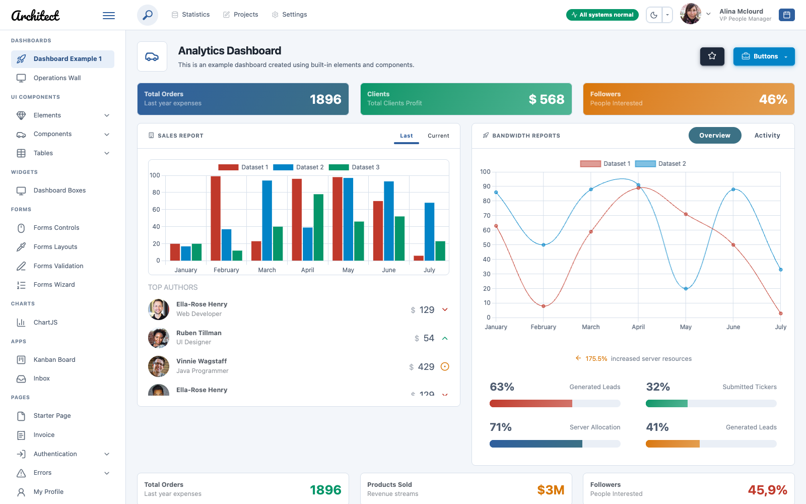

# ArchitectUI Bootstrap 5 HTML Theme

ArchitectUI is a clean, responsive admin dashboard theme. It is a thin layer on top of Bootstrap 5.3:
one stylesheet and one dependency-free script. Bootstrap and the icons come from a CDN, so any markup written
for Bootstrap 5 works inside the theme without changes, and you never rebuild Bootstrap.



**Demo:** https://wnikk.github.io/architectui-html-theme/

## What you get

- `dist/architectui.css` — the theme: layout, components, colors and dark mode in the default Business look, all driven by CSS variables.
- `dist/architectui.js` — the theme behavior of the admin pages: collapsible sidebar, interface settings, theme and mode switching, header search, file drop zone, icon rendering.
- `dist/architectui-auth.js` — the script of the guest pages (sign in, sign up, errors) instead of `architectui.js`: mode toggle, icons, form steps with a verification code.
- `dist/themes/*.css` — nine optional visual themes loaded on top of `architectui.css`, including Orange, the original ArchitectUI look.
- Wide screens and dense pages: grid and display classes `3xl` (from 1560 px) and `4xl` (from 1860 px) after Bootstrap `xxl` for 1600 and 1920 px monitors, a compact density setting, the Operations Wall demo page.
- `dist/*.html` — demo pages: dashboards (including the Operations Wall for wide screens), elements, every Bootstrap component on one page, a starter page, a profile page with the interface settings, guest pages (sign in, sign up, password reset, errors 403, 404 and 500, maintenance), Bootstrap tables and DataTables, components, forms (including a wizard in several steps), a Kanban board, an inbox, a user list with a modal form, a notifications center, an invoice ready for print, pricing plans, search results, the palettes of all themes, tables, charts, calendar and maps.
- Page path and print: breadcrumbs in the header or a path line with a Back link above the page title (`aui-page-path`, `data-aui-back`); print styles that put only the page content on paper in the light mode (`data-aui-print` opens the print dialog).
- No jQuery, no build step for your app. Icons are [Lucide](https://lucide.dev).

## Quick start

The built files are in the `dist/` folder of this repository, always the latest version
(its number is in `package.json` and `Changelog.md`). Take them in one of two ways.

**Download.** Download the repository as a [ZIP of the `master` branch](https://github.com/wnikk/architectui-html-theme/archive/refs/heads/master.zip)
or clone it. Copy from `dist/` the files `architectui.css`, `architectui.js` (and `architectui-auth.js` for sign-in pages),
the folders `themes/` and `assets/` to your project, then add to `<head>`:

```html
<link rel="stylesheet" href="https://cdn.jsdelivr.net/npm/bootstrap@5.3.8/dist/css/bootstrap.min.css">
<link rel="stylesheet" href="architectui.css">
<script defer src="https://cdn.jsdelivr.net/npm/bootstrap@5.3.8/dist/js/bootstrap.bundle.min.js"></script>
<script defer src="https://cdn.jsdelivr.net/npm/lucide@1.59.0/dist/umd/lucide.min.js"></script>
<script defer src="architectui.js"></script>
```

**From jsDelivr.** Link the latest files straight from the `master` branch of this repository.
A new version reaches the CDN within about 12 hours:

```html
<link rel="stylesheet" href="https://cdn.jsdelivr.net/gh/wnikk/architectui-html-theme@master/dist/architectui.css">
<script defer src="https://cdn.jsdelivr.net/gh/wnikk/architectui-html-theme@master/dist/architectui.js"></script>
```

Themes load from the folder next to `architectui.css`, so the theme setting and `data-aui-theme` work from the CDN too.
Logos, avatars and other images are part of your markup: copy `assets/` or point the `src` to the same CDN folder.

All links are relative, and every script is a classic `defer` script. The demo works from any folder of a local
server and from disk (`file://`). The theme script adds one global, `window.ArchitectUI`. Markup that a script inserts
later renders its icons, tooltips and popovers by itself. `ArchitectUI.token("primary")`, `ArchitectUI.rgba("primary", .5)`
and `ArchitectUI.chartDefaults(Chart)` give page scripts the colors of the current theme.

The demo pages link the theme files with `?v=<version>` (for example `architectui.css?v=6.2.0`), so a new release reaches
visitors past their browser cache. Do the same on your pages; the theme stylesheets keep the query.

Start from `dist/pages-starter.html` for a page with the frame (header, sidebar, page title, footer) and from
`dist/pages-login.html` for a page without it.

## Icons

Write an element with the icon name. The theme script turns it into an inline SVG:

```html
<i data-lucide="rocket"></i>
```

Icons take the text color and scale with the font size. `aui-icon-gradient-<color>` strokes an icon with a theme gradient.
The Icons demo page lists every icon with search and copy on click.

## Logo

Replace the files, nothing else:

- `assets/images/logo.png` — logo for light backgrounds;
- `assets/images/logo-on-dark.png` — logo for dark backgrounds (dark theme, dark header colors).

Wide and square logos both fit automatically. The maximum height is the `--aui-logo-max-height` variable (2.25rem).

## Themes

`architectui.css` alone draws the default look, Business. Nine more visual themes are optional. A theme is one extra
stylesheet loaded after `architectui.css`; it changes palette, typography, radii, shadows and table density, not the markup.

| Theme | File | Character |
|-------|------|-----------|
| Business (default) | none, built into `architectui.css` | Dense, smaller type, lines instead of shadows |
| Orange | `themes/orange.css` | The original ArchitectUI look: orange accents, color gradients, soft shadows |
| Indigo | `themes/indigo.css` | Indigo palette with the depth of Orange: soft shadows instead of lines, a floating header and sidebar, vivid two-color gradients |
| Indigo Calathea | `themes/indigo-img.css` | Indigo with a subtle photo of Calathea leaves behind the content |
| Coffee | `themes/coffee.css` | Warm browns with the depth of Orange (warm shadows, caramel and honey gradients) at the compact sizes of Business |
| Garden | `themes/green.css` | Calm green, serif headings, airy rows for long reading |
| Warm | `themes/raspberry.css` | Berry accent, pill buttons, rounder corners |
| Operations | `themes/teal.css` | Zebra tables, monospace numbers |
| Space | `themes/violet.css` | Large radii, soft violet shadows, heavy headings |
| Cyberpunk | `themes/cyberpunk.css` | Neon on black, monospace; dark only |

Pick a theme in the list next to the light/dark button in the header, or a theme and a mode (Light, Dark, System)
in the Interface section of the profile page (`pages-profile.html`). The choice is stored in `localStorage` and applied before the first paint.
To ship a fixed theme without the settings,
add the stylesheet yourself and put the theme id on `<html>`. The attribute switches the built-in Business values off:

```html
<html data-aui-theme="coffee">
<link rel="stylesheet" href="architectui.css">
<link rel="stylesheet" href="themes/coffee.css">
```

Theme sources live in `src/scss/themes/`. A new theme is one file: its palette for both modes, other variable values
and the rules only this theme needs. The shared rules of all themes come from `_theme.scss` and are part of
`architectui.css`. Two optional looks are mixins of the theme base: `t.depth()` gives a theme the soft shadows and
gradients of Orange in its own colors (Indigo, Coffee), `t.compact` gives it the compact sizes of Business (Coffee).
Add the theme to `src/_data/themes.json` to list it in the settings.

## Layout options

Layout modes are attributes on `<html>`. The Interface section of the profile page (`pages-profile.html`, user menu → Interface settings) changes them and remembers the choice in `localStorage`.

| Attribute | Values | Default |
|-----------|--------|---------|
| `data-aui-header` | `fixed`, `static` | `fixed` |
| `data-aui-sidebar` | `fixed`, `static` | `fixed` |
| `data-aui-footer` | `fixed`, `static` | `static` |
| `data-aui-sidebar-collapsed` | present or absent | absent |
| `data-aui-tabs` | `shadow`, `line` | `shadow` |
| `data-aui-density` | `compact`, or none for the normal density | none |
| `data-aui-header-scheme`, `data-aui-sidebar-scheme` | `primary`, `secondary`, `success`, `info`, `warning`, `danger`, `light`, `dark`, `focus`, `alternate` | none |
| `data-aui-mode` | `light`, `dark`, `system` | `light` |
| `data-aui-theme` | theme id from the table above, or none for Business | none |
| `data-bs-theme` | `light`, `dark` — set by the theme script from the mode | `light` |

The sidebar is full width from 1200 px, an icon rail from 768 px (it expands on hover or keyboard focus) and an off-canvas panel below 768 px.

For monitors 1600 and 1920 px wide, the grid continues after `xxl`: `col-3xl-*`, `row-cols-3xl-*`, `g-3xl-*`, `d-3xl-*` from 1560 px and the same `4xl` classes from 1860 px. The compact density (`data-aui-density="compact"`) makes the frame gutter, cards and tables denser in every theme.

## Theme colors

All colors are CSS variables. Override them after `architectui.css`, no rebuild needed:

```css
:root {
  --bs-primary: #3f6ad8;
  --bs-primary-rgb: 63, 106, 216;
}
```

The theme adds `focus`, `alternate` and `tertiary` to the Bootstrap color set (`btn-focus`, `bg-alternate`, `text-focus` and so on).

The Theme Palettes demo page (`elements-palettes.html`) shows every color of every theme in both modes with its class,
variable and HEX value, and explains how to use the colors in markup, CSS and scripts.

## For AI agents

- [`llms.txt`](llms.txt) — short description of the theme and links, in the [llms.txt](https://llmstxt.org) format.
- [`llms-full.txt`](llms-full.txt) — complete usage reference: page template, frame markup, settings, script API, themes, tokens, component classes.
- [`AGENTS.md`](AGENTS.md) — short how-to for agents: which files to take, how to build a page, settings, customizing, rules.

## Development

Requires Node 22 or newer.

```bash
npm install
npm run dev
```

`npm run dev` serves the demo at http://localhost:8080 and rebuilds pages and styles on change. `npm run build` writes the built files into `dist/`.

| Path | Purpose |
|------|---------|
| `src/pages/*.html` | Demo pages. Front matter holds the title, description and icon; `breadcrumbs` (`header` or `title`) shows the page path, `titleActions` names the partial with the title buttons, `printTitle: false` keeps the title off paper. |
| `src/pages/*.js` | Scripts of individual pages (charts, Operations Wall, calendar, maps, notifications, icons, validation, forms wizard, Kanban, inbox, users, notifications, pricing, search, profile, DataTables). |
| `src/_includes/` | Page layouts (`base.njk` with the admin frame, `guest.njk` for sign-in and error pages) and partials (Eleventy + Nunjucks). |
| `src/_data/menu.json` | Sidebar menu; the page path (breadcrumbs) is built from it. |
| `src/_data/themes.json` | Theme list of the header and the profile page. |
| `src/_data/palettes.js` | Colors of every theme in both modes, collected from the theme sources at build (Theme Palettes page). |
| `src/_data/orders.js` | Demo orders for the table pages. |
| `src/_data/operations.js`, `kanban.js`, `inbox.js`, `invoice.js`, `users.js`, `pricing.js`, `notifications.js`, `search.js` | Demo data of the Operations Wall, Kanban, Inbox, Invoice, Users, Pricing and Notifications pages (the last one also feeds the bell in the header); `search.js` builds the search index from the menu and the other data. |
| `src/_data/cdn.json` | Every external URL. Point them to a local `vendor/` folder to work offline. |
| `src/scss/` | Theme styles. `architectui.scss` is the entry point. |
| `src/js/architectui.js` | Theme script of the admin pages. |
| `src/js/architectui-auth.js` | Script of the guest pages. |

The demo pages are built with [Eleventy 3](https://www.11ty.dev), the styles with [Sass](https://sass-lang.com). These are the only two dependencies.

The Maps page uses public OpenStreetMap tiles. They are fine for a demo; use your own tile server or a tile provider in production.

## License

MIT, see [LICENSE](LICENSE).

## Authors

Forked from [DashboardPack ArchitectUI HTML Theme Free](https://github.com/DashboardPack/architectui-html-theme-free) and maintained by the community.
